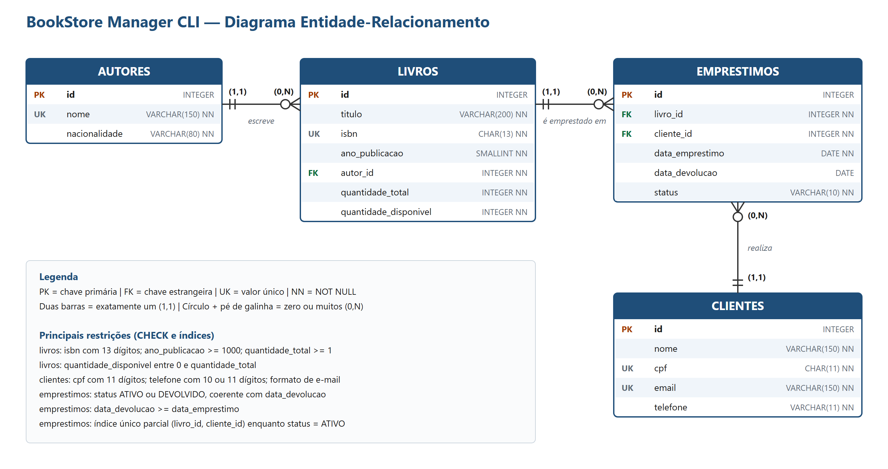

# BookStore Manager CLI

Sistema de gerenciamento de uma pequena livraria, executado pelo terminal e desenvolvido em Node.js com TypeScript. Controla autores, livros, clientes, empréstimos e devoluções.

O repositório também traz o projeto do banco de dados em PostgreSQL: o DER e o `script.sql`.

> **Importante:** a aplicação não se conecta ao banco de dados. Ela mantém os dados em memória durante a execução, e tudo o que foi alterado se perde ao encerrar. O banco é modelado e executado separadamente, pelo `script.sql`. Os dois usam os mesmos dados de exemplo.

**Vídeo de apresentação:** _(adicionar o link aqui)_

**Kanban:** _(adicionar o link aqui)_

## Objetivo

Substituir os registros manuais da livraria por uma aplicação organizada em camadas, que aplique as regras de negócio, e entregar o banco de dados relacional com os relatórios gerenciais em SQL.

## Tecnologias utilizadas

- Node.js e TypeScript
- tsx (execução em desenvolvimento)
- `node:readline` (menus no terminal)
- PostgreSQL (DDL, DML e relatórios)
- Git, GitHub e GitFlow

## Requisitos para execução

- [Node.js](https://nodejs.org/) 20 ou superior, com npm
- [Git](https://git-scm.com/)
- [PostgreSQL](https://www.postgresql.org/download/) com o `psql` disponível no terminal (necessário só para o banco de dados)

## Instalação

```bash
git clone https://github.com/MurilloPaim/bookstore-manager-cli.git
cd bookstore-manager-cli
npm install
```

## Execução

| Comando | O que faz |
|---|---|
| `npm run dev` | Executa a aplicação em modo de desenvolvimento |
| `npm run build` | Compila o TypeScript para a pasta `dist/` |
| `npm start` | Executa a versão compilada (rode o `build` antes) |

## Banco de dados

### Diagrama Entidade-Relacionamento



- Um autor pode ter vários livros, e cada livro pertence a um único autor.
- Um livro pode ter vários empréstimos, e cada empréstimo se refere a um único livro.
- Um cliente pode ter vários empréstimos, e cada empréstimo pertence a um único cliente.

### Execução do script SQL

Execute os comandos na raiz do projeto. O PostgreSQL pedirá a senha do usuário informado.

No Windows, para exibir os acentos corretamente no terminal, rode antes:

```powershell
chcp 65001
```

1. Crie o banco de dados:

   ```bash
   psql -U postgres -c "CREATE DATABASE bookstore ENCODING 'UTF8' TEMPLATE template0;"
   ```

2. Execute o script completo:

   ```bash
   psql -U postgres -d bookstore -f database/script.sql
   ```

3. Confira as tabelas criadas:

   ```bash
   psql -U postgres -d bookstore -c "\dt"
   ```

O script pode ser executado novamente, pois recria as tabelas no início. Na primeira execução, os avisos `NOTICE: table ... does not exist, skipping` são normais.

### Organização do `script.sql`

1. **DDL:** criação das tabelas, com PK, FK, `NOT NULL`, `UNIQUE` e `CHECK`.
2. **DML:** `INSERT` com os dados de `src/data/seed.ts`, demonstrações de `UPDATE` e `DELETE` e `SELECT` de conferência.
3. **Relatórios:**
   - livros disponíveis;
   - livros emprestados;
   - livros cadastrados por autor;
   - quantidade de empréstimos por livro;
   - clientes com empréstimos ativos;
   - extras: os 3 livros mais emprestados e a situação do acervo por autor.

## Arquitetura do projeto

```text
Usuário → Menu → Controller → Service → Repository → Dados em memória
```

| Camada | Responsabilidade |
|---|---|
| **Main** | Monta as dependências, carrega o seed e inicia o menu principal |
| **Menus** | Exibem as opções e direcionam a escolha do usuário |
| **Controllers** | Recebem os dados do terminal, chamam os services e exibem os resultados |
| **Services** | Aplicam as regras de negócio e coordenam os repositories |
| **Repositories** | São os únicos que acessam os dados em memória, guardados em um `Map` |
| **Models** | Definem entidades, interfaces, tipos e erros |
| **Utils** | Reúnem validações, formatações, mensagens e leitura do terminal |
| **Data** | Guarda os dados iniciais (seed) |
| **Database** | Fora de `src/`: contém o DER e o `script.sql` |

Os services dependem de interfaces, como `ILivroRepository`, e não das classes concretas. Essas dependências são recebidas pelo construtor, em `main.ts`. Como os métodos de services e repositories já são assíncronos, uma futura troca da memória por um banco de dados exigiria apenas novas implementações dos repositories.

## Funcionalidades implementadas

- **Autores:** cadastrar, listar, consultar por ID, atualizar e remover.
- **Livros:** cadastrar, listar, consultar por ID, buscar por título, atualizar e remover.
- **Clientes:** cadastrar, listar, consultar por ID, atualizar e remover.
- **Empréstimos:** realizar, registrar devolução, listar todos, listar ativos e consultar por ID.

### Regras de negócio

- Autor: o nome não pode se repetir, sem diferenciar maiúsculas de minúsculas.
- Livro: precisa de um autor existente; o ISBN é único e tem 13 dígitos.
- Cliente: CPF (11 dígitos) e e-mail são únicos; o telefone tem 10 ou 11 dígitos.
- Empréstimo: exige livro existente, cliente existente e exemplar disponível, e reduz a quantidade disponível em 1.
- Um cliente não pode pegar outro exemplar de um livro que ainda está com ele.
- Devolução: aumenta a quantidade disponível em 1 e não pode ser repetida.
- A quantidade total de um livro não pode ficar menor que a de exemplares emprestados.
- Autor com livros não pode ser removido.
- Livro ou cliente com empréstimos registrados não pode ser removido, mesmo após a devolução, para preservar o histórico.

Situações inválidas exibem uma mensagem clara e a aplicação continua em execução.

## Estrutura de pastas

```text
bookstore-manager-cli/
├── database/
│   ├── der.png
│   └── script.sql
├── src/
│   ├── main.ts
│   ├── controllers/   # AutorController, LivroController, ClienteController, EmprestimoController
│   ├── data/          # seed.ts
│   ├── menus/         # Menu e funções que criam cada menu
│   ├── models/        # Autor, Livro, Cliente, Emprestimo, Entidade, erros
│   ├── repositories/  # Repository, RepositoryEmMemoria e um repositório por entidade
│   ├── services/      # AutorService, LivroService, ClienteService, EmprestimoService
│   └── utils/         # Terminal, validacoes, formatadores, mensagens
├── .gitignore
├── package.json
├── package-lock.json
├── README.md
└── tsconfig.json
```

## Exemplos de utilização

Menu principal:

```text
=== BookStore Manager CLI ===
1 - Autores
2 - Livros
3 - Clientes
4 - Empréstimos
0 - Encerrar aplicação
Escolha uma opção:
```

Cadastro de autor:

```text
Nome: José Saramago
Nacionalidade: Portuguesa
[OK] Autor cadastrado: #7 - José Saramago | Nacionalidade: Portuguesa
```

Consulta de um livro:

```text
ID do livro: 1
#1 - Dom Casmurro | Autor: Machado de Assis | ISBN: 9780000000001 | Ano: 1899 | Disponíveis: 2/3
```

Listagem de empréstimos:

```text
#1 - Livro: Dom Casmurro | Cliente: Ana Souza | Empréstimo: 01/09/2026 | Devolução: 15/09/2026 | Status: DEVOLVIDO
#2 - Livro: A Hora da Estrela | Cliente: Bruno Lima | Empréstimo: 20/09/2026 | Status: ATIVO
```

Situações tratadas:

```text
[ERRO] O livro "A Hora da Estrela" não tem exemplares disponíveis.
[ERRO] Empréstimo com ID 99 não encontrado.
[ERRO] Já existe um cliente cadastrado com o CPF 00000000101.
[ERRO] O autor com ID 1 possui 2 livro(s) cadastrado(s) e não pode ser removido.
[ERRO] O campo "ID do autor" deve ser um número inteiro válido.
```

Os dados de clientes e os ISBNs são fictícios, criados apenas como exemplo.

## Branches

| Branch | Finalidade |
|---|---|
| `main` | Versão final do projeto |
| `develop` | Integração das funcionalidades |
| `feat/estrutura-base` | Erros, repositório genérico, terminal e menu |
| `feat/autores` | Gerenciamento de autores |
| `feat/livros` | Gerenciamento de livros |
| `feat/clientes` | Gerenciamento de clientes |
| `feat/emprestimos` | Empréstimos e devoluções |
| `feat/banco-dados` | DER e `script.sql` |
| `docs/readme` | Documentação |

## Observações para Windows

Se o PowerShell bloquear o `npm` com a mensagem `npm.ps1 não pode ser carregado`, execute uma vez:

```powershell
Set-ExecutionPolicy -Scope CurrentUser -ExecutionPolicy RemoteSigned
```

## Integrantes da equipe

- Murilo Paim — [github.com/MurilloPaim](https://github.com/MurilloPaim)
